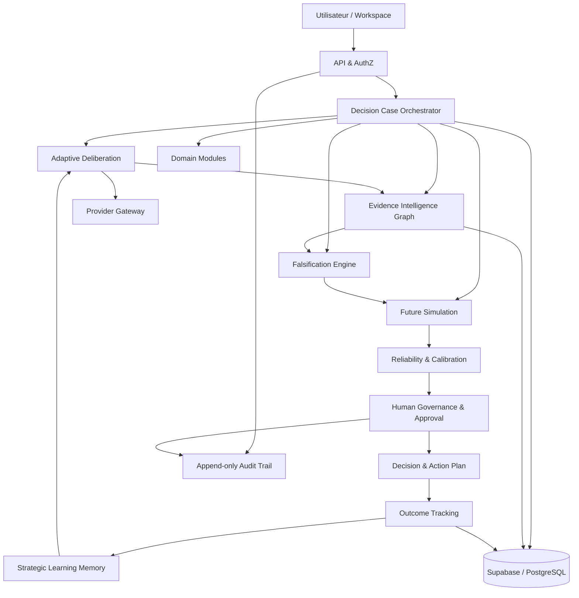

# AFE-CI Debate Engine V2 — Blueprint stratégique et technique

> **Document de référence — version 2.0.0-draft.1**  
> Statut : proposition d'architecture soumise à validation  
> Date : 3 novembre 2026  
> Périmètre : dépôt `eddiecoulibaly1-dotcom/-afe-ci-independant`, branche `feature/debate-engine-v2-1`  
> Référence de compatibilité : produit V1.0.7 et évolution V1.0.x/V1.1.x  
> Production : branche `main` — hors périmètre de toute modification décrite ici

---

## 0. Gouvernance du document

Ce document est la référence de conception pour les futures évolutions du Debate Engine. Il décrit une **cible**, pas une déclaration que toutes les fonctions sont déjà implémentées.

### 0.1 Statut des informations

Chaque élément de conception doit être interprété selon l'une des catégories suivantes :

- **EXISTANT OBSERVÉ** : fichier, table, endpoint ou comportement repéré dans le dépôt de la branche auditée.
- **CIBLE V2** : capacité souhaitée et spécifiée ici.
- **PROPOSITION** : choix technique recommandé, à confirmer par revue et tests.
- **À VALIDER** : information manquante ou arbitrage produit/technique qui bloque une implémentation définitive.
- **HORS PÉRIMÈTRE** : explicitement exclu de la première livraison V2.

Une présence dans le dépôt ne vaut pas adoption architecturale. Une fonction décrite dans ce Blueprint ne vaut pas preuve d'implémentation ou de fonctionnement en production.

### 0.2 Règles de modification

1. Ce document évolue par versions : toute modification de portée, de contrat ou de modèle de données doit être datée dans l'historique.
2. Une décision architecturale structurante doit être enregistrée dans un ADR (Architecture Decision Record) avec contexte, options, décision, conséquences et statut.
3. Aucun changement de schéma SQL, d'API ou de comportement de production ne peut être justifié par une simple mention du Blueprint : il faut une tâche, des tests et une revue.
4. Les migrations déjà appliquées sont immuables. Toute évolution SQL est additive, versionnée, testée sur une base isolée et accompagnée d'un plan de retour.
5. Toute fonctionnalité nouvelle doit démontrer sa valeur par un scénario d'acceptation et une métrique.
6. Les secrets, clés fournisseurs, données personnelles et données de décision sensibles ne doivent jamais être ajoutés à ce document ni aux journaux applicatifs.
7. Les changements restent sur une branche de travail et sont livrés par pull request. Aucun déploiement production ni fusion vers `main` n'est implicite.

### 0.3 Historique des versions

| Version | Date | Statut | Objet |
|---|---|---|---|
| 2.0.0-draft.1 | 2026-11-03 | Brouillon de référence | Première architecture unifiée, exigences, contrats, métriques, migration et benchmark initial |

### 0.4 Conditions de validation du Blueprint

Le document peut passer à `2.0.0-approved` lorsque :
- le propriétaire produit valide le positionnement, les priorités et les exclusions ;
- les contrats de données et les limites de la V1.0.7 sont confirmés par audit du code et de la base ;
- les produits concurrents sont identifiés sans ambiguïté ;
- les critères d'acceptation et le plan de migration sont acceptés ;
- les décisions « À VALIDER » bloquantes sont résolues ou explicitement reportées.

---

## 1. Vision stratégique et positionnement

### 1.1 Ambition

AFE-CI doit devenir une **infrastructure de délibération et de gouvernance de décision**. Sa valeur ne réside pas dans le nombre d'agents, le nombre de modèles ou la longueur des débats, mais dans sa capacité à produire une décision :
- contradictoirement examinée ;
- reliée à des preuves traçables et datées ;
- exposée à des tentatives actives de réfutation ;
- comparée à des futurs possibles et à leurs conséquences ;
- assortie d'incertitudes, de conditions de révision et d'un plan d'action ;
- soumise à l'approbation humaine lorsque le risque l'exige ;
- suivie dans le temps afin de comparer les résultats réels aux hypothèses initiales.

**Promesse produit proposée :** « AFE-CI aide les organisations à prendre des décisions mieux éprouvées, explicables, gouvernables et apprenantes. »

AFE-CI ne promet pas de vérité absolue, de prédiction certaine ni de décision automatiquement correcte. Il rend visibles les éléments qui soutiennent ou fragilisent une décision, et permet de la réexaminer lorsque les faits changent.

### 1.2 Positionnement distinctif visé

Le positionnement recherché est l'intégration cohérente de sept disciplines :
1. délibération contradictoire adaptative ;
2. gestion structurée des preuves ;
3. falsification et recherche de contre-exemples ;
4. exploration de scénarios et de conséquences ;
5. gouvernance et intervention humaine ;
6. suivi des décisions et de leurs résultats ;
7. apprentissage stratégique mesuré et contrôlé.

La différenciation ne sera revendiquée qu'après un benchmark reproductible. Une liste de fonctionnalités ou une déclaration marketing ne suffit pas à établir une supériorité.

### 1.3 Principes non négociables

- **Evidence before confidence** : la confiance ne peut pas être déduite du seul consensus des modèles.
- **Disagreement is data** : les désaccords pertinents sont conservés, pas artificiellement effacés.
- **Falsifiability** : une recommandation doit préciser ce qui pourrait la réfuter.
- **Human accountability** : l'IA conseille, l'autorité désignée décide.
- **Reversibility** : privilégier les décisions réversibles et les pilotes lorsque l'incertitude est élevée.
- **Auditability** : chaque conclusion doit pouvoir être reliée à ses entrées, versions, preuves et interventions.
- **Separation of duties** : le moteur qui recommande ne doit pas être l'unique contrôleur de sa propre qualité.
- **No fabricated evidence** : une source citée n'est pas automatiquement vérifiée ; une donnée absente reste absente.
- **Cost-aware intelligence** : profondeur et coût doivent être proportionnés aux enjeux.
- **Backward compatibility** : la V2 enrichit la V1 sans effacer l'historique ni casser les contrats existants.

---

## 2. Périmètre fonctionnel : les dix piliers

Les dix piliers sont des capacités du système, non dix agents autonomes. Plusieurs capacités peuvent être exécutées par un même service déterministe ou par des appels de modèles différents selon le besoin.

### Pilier 1 — Intelligence contradictoire adaptative

**But :** adapter les objections aux faiblesses réellement observées dans les arguments, hypothèses, données et preuves.

Entrées :
- question et contexte du cas ;
- options et critères de décision ;
- arguments et hypothèses structurés ;
- graphe de preuves ;
- désaccords et lacunes détectés ;
- contraintes de coût, délai et niveau de risque.

Traitement :
1. extraire les affirmations atomiques ;
2. identifier hypothèses, dépendances et critères ;
3. classer les faiblesses (preuve manquante, causalité fragile, généralisation, biais d'échantillon, incohérence, risque d'exécution, dépendance externe) ;
4. sélectionner les défis les plus discriminants ;
5. demander des réponses ciblées ;
6. vérifier si la réponse traite réellement l'objection ;
7. mettre à jour le statut de l'affirmation sans effacer son historique.

Sorties :
- défi formulé ;
- affirmation ciblée ;
- type et gravité de la faiblesse ;
- justification du choix ;
- réponse et qualité de réponse ;
- statut : ouvert, traité, partiellement traité, réfuté, non testable.

Critère d'acceptation : sur un jeu d'essai annoté, au moins 80 % des faiblesses critiques connues doivent être détectées ou explicitement marquées hors capacité ; le taux de défis non pertinents doit rester inférieur à 15 %. Ces seuils sont des objectifs initiaux à recalibrer.

### Pilier 2 — Evidence Intelligence Graph

**But :** représenter les affirmations, preuves, sources, observations, contradictions et liens de dépendance.

Objets :
- Claim : affirmation atomique et son périmètre ;
- Evidence : élément probant ou contre-probant ;
- Source : origine identifiable d'une preuve ;
- Observation : mesure, événement ou donnée collectée ;
- Check : opération de vérification ;
- Relation : supporte, contredit, nuance, dérive de, dépend de ;
- Snapshot : état du graphe au moment d'une décision.

Règles :
- conserver URL, auteur/organisme si connu, date de publication, date de collecte, type de source et extrait strictement nécessaire ;
- distinguer date de publication et date de récupération ;
- stocker le statut de vérification séparément de la pertinence ;
- ne pas confondre une référence fournie par un modèle et une source effectivement consultée ;
- conserver les versions et corrections ;
- afficher les sources expirées, contradictoires ou inaccessibles ;
- tracer la chaîne Claim → Evidence → Source → Check → Decision.

Statuts de source recommandés : `unverified`, `reachable`, `content_checked`, `corroborated`, `contradicted`, `stale`, `unavailable`, `rejected`.

Une source peut être accessible sans confirmer l'affirmation. La vérification sémantique est distincte du contrôle HTTP.

### Pilier 3 — Falsification Engine

**But :** rechercher activement les observations qui invalideraient la conclusion privilégiée.

Protocole :
1. traduire la conclusion en hypothèses réfutables ;
2. définir les conditions nécessaires à sa validité ;
3. rechercher contre-exemples, données négatives, scénarios extrêmes, explications alternatives et événements de rupture ;
4. classer les tests par pouvoir discriminant, coût et délai ;
5. exécuter uniquement les recherches autorisées ;
6. évaluer les résultats avec leur provenance ;
7. conclure : non réfutée à ce stade, fragilisée, réfutée, ou non testable.

Le moteur doit aussi falsifier l'option opposée : il ne doit pas favoriser systématiquement la première recommandation.

Sortie minimale par test : hypothèse ciblée, méthode, résultat attendu si l'hypothèse est vraie, résultat attendu si elle est fausse, données nécessaires, coût, résultat observé, limites, conclusion et lien de preuve.

### Pilier 4 — Future Simulation Engine

**But :** comparer des futurs possibles, sans les présenter comme des prédictions certaines.

Chaque scénario comprend :
- horizon temporel (court, moyen, long, avec dates configurables) ;
- hypothèses et variables ;
- conditions initiales ;
- mécanismes causaux supposés ;
- événements déclencheurs ;
- effets de premier et de second ordre ;
- indicateurs avancés ;
- conséquences, risques et opportunités ;
- facteurs qui invalideraient le scénario.

Types de scénarios :
- central / continuité ;
- favorable ;
- défavorable ;
- stress extrême ;
- rupture / changement de régime ;
- scénario alternatif proposé par l'utilisateur.

Les probabilités ne sont affichées que si une méthode et des données justifient leur estimation. Sinon, utiliser des catégories qualitatives ou des fourchettes explicitement subjectives. Toujours séparer faits, hypothèses et jugement expert.

### Pilier 5 — Apprentissage des résultats passés

**But :** comparer les hypothèses et recommandations aux résultats réellement observés.

Le système conserve :
- la décision approuvée et son auteur ;
- les hypothèses et niveaux de confiance à la date de décision ;
- les résultats attendus et indicateurs ;
- les événements observés ;
- la qualité et la complétude des données de suivi ;
- les écarts et explications possibles ;
- les enseignements validés ou encore hypothétiques.

Aucun modèle ne doit modifier seul ses propres poids ou seuils en production. L'apprentissage suit un processus contrôlé : collecte → évaluation → proposition de changement → test hors production → approbation → déploiement versionné.

### Pilier 6 — Suivi post-décision

**But :** transformer chaque décision suivie en boucle de contrôle.

Cadences proposées par défaut : J+30, J+90, J+180 et J+365, configurables par domaine et par décision. Les rappels sont adaptés au cycle réel ; les dates ne doivent pas être imposées si elles n'ont pas de sens.

Le suivi compare :
- KPI cible et KPI constaté ;
- hypothèse initiale et observation ;
- budget/délai prévus et réalisés ;
- risques identifiés et incidents ;
- conditions de révision déclenchées ou non.

Statuts : `planned`, `active`, `on_track`, `at_risk`, `off_track`, `review_required`, `completed`, `cancelled`.

### Pilier 7 — Intervention humaine

**But :** permettre une intervention à n'importe quelle étape du cycle.

Actions :
- demander une précision ;
- ajouter une preuve ou une pièce ;
- contester une source ;
- ajouter une contrainte ;
- suspendre le processus ;
- demander un nouveau test ;
- imposer un scénario ;
- modifier un seuil de risque avec justification ;
- demander une seconde revue ;
- reprendre ou clôturer un cas.

Toute intervention est datée, attribuée à un utilisateur, associée à une raison et conservée dans le journal. Une intervention ne doit jamais être silencieusement écrasée par une exécution ultérieure.

### Pilier 8 — Mémoire stratégique

**But :** réutiliser les enseignements de décisions précédentes sans transformer une expérience isolée en vérité générale.

La mémoire est segmentée :
- mémoire du cas ;
- mémoire de l'organisation / workspace ;
- mémoire de domaine ;
- mémoire de leçons validées.

Chaque élément mémorisé porte : origine, date, domaine, contexte d'application, niveau de validation, portée, durée de conservation, sensibilité, autorisation d'usage et lien vers les cas d'origine.

Une leçon n'est réutilisable comme règle qu'après validation humaine ou procédure d'évaluation définie. Les mémoires obsolètes sont signalées, pas effacées silencieusement.

### Pilier 9 — Modules spécialisés par domaine

**But :** fournir des cadres, taxonomies, règles et indicateurs adaptés à un domaine, sans dupliquer le moteur central.

Premiers domaines candidats :
- finance et investissement ;
- agriculture et agro-industrie ;
- droit et conformité ;
- stratégie et développement ;
- gouvernance et organisation ;
- risques et contrôle ;
- opérations et technologie.

Un module de domaine contient :
- version et propriétaire ;
- vocabulaire et taxonomie ;
- critères d'analyse ;
- risques typiques ;
- sources autorisées ou recommandées ;
- exigences réglementaires à vérifier ;
- métriques pertinentes ;
- limites et avertissements.

Le module ne remplace jamais un avis professionnel obligatoire. Les domaines juridique, médical, financier réglementé ou à fort impact imposent des garde-fous et une validation humaine appropriée.

### Pilier 10 — Approbation et gouvernance décisionnelle

**But :** faire de l'approbation un état explicite du cycle, et non un simple bouton final.

États recommandés :
`draft → analyzing → review_required → awaiting_approval → approved | rejected | returned_for_revision → executing → monitoring → closed`.

La transition doit vérifier :
- rôle et autorisation de l'approbateur ;
- niveau de risque ;
- preuves et objections critiques ;
- réserves non résolues ;
- conditions et limites de la recommandation ;
- existence d'un plan de suivi si requis.

Une décision peut rester `provisional` même si l'utilisateur l'approuve. Approbation humaine et niveau de preuve sont deux dimensions distinctes.

---

## 3. Architecture cible

### 3.1 Architecture logique

Le système s'organise autour d'un **Decision Case** et de services spécialisés. Les services sont des frontières de responsabilité, pas nécessairement des microservices déployés séparément.



### 3.2 Couches

1. **Experience** : application web/PWA, tableau de bord, timeline, vue graphe, approbations, suivi.
2. **API & Identity** : authentification, autorisation par ressource, limites, validation d'entrée.
3. **Orchestration** : état du cas, étapes durables, leases, retries, reprise et idempotence.
4. **Intelligence** : délibération, preuves, falsification, simulation, domaine, calibration.
5. **Governance** : intervention, approbation, séparation des rôles, contrôle des transitions.
6. **Persistence** : PostgreSQL/Supabase, stockage de pièces, journal d'événements, snapshots.
7. **Provider Gateway** : adaptateurs OpenAI/Gemini/autres, budgets, timeouts, retries, fallback.
8. **Observability** : logs structurés, métriques, traces, coût, latence et incidents.

### 3.3 Orchestrateur déterministe

L'orchestrateur reste le propriétaire du cycle de vie. Les modèles ne contrôlent jamais directement :
- l'état global d'un cas ;
- le nombre maximal de tentatives ;
- les transitions de gouvernance ;
- les autorisations ;
- l'écriture des approbations ;
- les règles de clôture ;
- les calculs déterministes de score ou d'indicateurs.

Chaque étape doit être :
- identifiée par un ID stable ;
- idempotente ;
- persistée avant de passer à la suivante ;
- récupérable après interruption ;
- bornée par timeout, budget et nombre de tentatives ;
- observable avec résultat et code d'erreur.

### 3.4 Contrat commun des composants

Chaque service reçoit un contexte typé et versionné, jamais un objet libre non validé.

Enveloppe logique recommandée :

```ts
type ServiceEnvelope<T> = {
  schemaVersion: string;
  caseId: string;
  workspaceId: string;
  correlationId: string;
  idempotencyKey: string;
  actor: { type: "user" | "system"; id: string };
  input: T;
  constraints: {
    deadlineAt?: string;
    maxCostMicros?: number;
    sensitivity: "normal" | "confidential" | "restricted";
  };
};
```

Les réponses incluent `status`, `data`, `warnings`, `errors`, `provenance`, `modelVersion` si un modèle a été utilisé, et `createdAt`. Les sorties des modèles sont validées par schéma strict et normalisées avant persistance.

### 3.5 Exécution et résilience

- Un travail asynchrone est enregistré avant son exécution.
- Les workers revendiquent une étape avec lease et expiration.
- Une étape expirée peut être reprise sans double écriture.
- Les erreurs transitoires sont retentées avec backoff exponentiel et jitter.
- Les erreurs de schéma, d'autorisation ou d'entrée ne sont pas retentées à l'aveugle.
- Le fallback fournisseur conserve le même contrat de sortie et la trace du modèle utilisé.
- Le résultat de continuité ne doit pas être présenté comme un verdict issu d'une analyse complète : il est étiqueté explicitement « continuité / analyse non exécutée ».
- Les budgets de coût et de temps peuvent interrompre une profondeur d'analyse ; la sortie doit alors indiquer ce qui n'a pas été exécuté.

---

## 4. Cycle de délibération V2

### 4.1 Étapes canoniques

1. **Intake** : question, contexte, objectif, décideur, échéance, sensibilité.
2. **Classification** : domaine, type de décision, niveau d'enjeu, réversibilité.
3. **Structuration** : options, critères, contraintes, hypothèses, dépendances.
4. **Positions indépendantes** : analyse initiale sans exposition mutuelle, lorsque la diversité des points de vue est requise.
5. **Evidence pass** : extraction des claims et rattachement aux preuves.
6. **Adaptive challenge** : défis choisis à partir des faiblesses observées.
7. **Falsification** : recherche active des éléments invalidants.
8. **Scenario pass** : scénarios et conséquences.
9. **Reliability pass** : vérification des schémas, preuves, contradictions, incertitudes, calibration.
10. **Human review** : demande de clarification, validation ou retour pour révision.
11. **Decision record** : recommandation, réserves, conditions, plan d'action.
12. **Outcome tracking** : mesure et apprentissage post-décision.

### 4.2 Adaptation des défis

Le moteur calcule une priorité de défi à partir de facteurs explicables :
- impact potentiel de l'affirmation ;
- faiblesse de preuve ;
- incertitude ;
- dépendance à une hypothèse ;
- contestation par une source ;
- réversibilité de la décision ;
- coût de vérification.

Formule initiale indicative, à calibrer sur des cas annotés :

`ChallengePriority = 0.30 × Impact + 0.25 × EvidenceGap + 0.20 × Uncertainty + 0.15 × Dependency + 0.10 × ReversalCost`

Chaque facteur est normalisé de 0 à 100. Les pondérations sont versionnées et ne doivent pas être modifiées sans benchmark. Le moteur doit exposer le détail du calcul et permettre une surcharge humaine justifiée.

### 4.3 Critères d'arrêt

Le débat peut s'arrêter si :
- les tests critiques sont traités ou explicitement non testables ;
- aucune objection à fort impact ne reste sans réponse ;
- les preuves essentielles sont suffisamment vérifiées ;
- le budget ou le délai est atteint ;
- une décision humaine de suspension est prise ;
- le nombre maximal de cycles est atteint.

L'arrêt ne signifie pas consensus. Les statuts de sortie comprennent :
- `supported` : éléments convergents suffisants dans le périmètre testé ;
- `provisional` : recommandation possible avec réserves ;
- `unresolved` : arbitrage non justifié ;
- `rejected` : hypothèse ou option invalidée ;
- `insufficient_evidence` : données insuffisantes ;
- `not_run` : analyse interrompue ou non exécutée.

---

## 5. Modèle Evidence Graph

### 5.1 Entités logiques

| Entité | Champs essentiels |
|---|---|
| Claim | id, case_id, statement, claim_type, scope, polarity, materiality, status, created_by |
| Evidence | id, claim_id, evidence_type, excerpt, observed_value, unit, period, direction |
| Source | id, name, source_type, url, publisher, published_at, retrieved_at, jurisdiction |
| EvidenceCheck | id, evidence_id, method, status, checked_at, checker, result, limitations |
| Relation | id, from_type, from_id, relation_type, to_type, to_id |
| Snapshot | id, case_id, graph_version, captured_at, digest |
| Contradiction | id, claim_id, evidence_ids, severity, resolution_status, resolution_note |

### 5.2 Contraintes

- Les IDs sont stables et les références doivent être vérifiables.
- Les données source brutes sont immuables ou versionnées ; les corrections sont append-only.
- Une citation de modèle est initialement `unverified`.
- Une source peut soutenir une affirmation sur une période et la contredire sur une autre.
- Les relations ont un auteur, une date et une justification.
- Les extraits sont minimisés pour respecter droits d'auteur et confidentialité.
- Les liens cassés ne suppriment pas les métadonnées et l'historique.
- Les documents confidentiels ont une politique d'accès et de rétention distincte.

### 5.3 Score de preuve

Le score de preuve n'est pas une vérité mathématique. Il sert à prioriser l'examen et doit être décomposé :
- autorité / compétence de la source ;
- proximité avec le fait observé ;
- actualité ;
- indépendance ;
- méthode et reproductibilité ;
- cohérence avec d'autres éléments ;
- biais ou limites identifiés.

Ne jamais présenter un score global sans les composantes et les avertissements. Les seuils doivent être calibrés par domaine.

### 5.4 Compatibilité avec l'existant

**EXISTANT OBSERVÉ :** les tables `debate_evidence`, `debate_hypotheses`, `debate_events`, `debate_decisions` existent dans la migration de schéma du moteur. Le dépôt comprend également `src/evidence.ts`.

**PROPOSITION :** étendre ces structures ou créer des tables liées uniquement après comparaison détaillée des champs, politiques RLS, volumes et besoins de requêtes. Ne pas créer une seconde famille de tables Claim/Evidence/Source si les structures existantes peuvent évoluer proprement. Aucun nom de table proposé ici n'est une instruction de migration immédiate.

---

## 6. Protocole de falsification

Pour chaque décision, produire une **Falsification Plan** comprenant :

1. conclusion candidate ;
2. hypothèses nécessaires ;
3. conditions qui doivent être vraies ;
4. éléments qui pourraient invalider chaque hypothèse ;
5. test ou recherche ;
6. données et sources nécessaires ;
7. seuil de réfutation défini avant le test ;
8. résultat ;
9. limites du test ;
10. décision de mise à jour.

Exemple générique :
- Hypothèse : le volume de demande permet une exploitation rentable.
- Falsificateurs : demande surestimée, saisonnalité, coût logistique supérieur, concurrence réactive, rupture d'approvisionnement.
- Test : pilote sur une période représentative, mesure des commandes réelles, marge nette, annulations et réachat.
- Règle : si la marge contributive reste négative après la période définie ou si le volume minimum n'est pas atteint, réviser l'option.

Le seuil et la période doivent être définis selon le cas, pas inventés par le moteur.

---

## 7. Simulation des futurs possibles

### 7.1 Contrat de scénario

```ts
type Scenario = {
  id: string;
  caseId: string;
  name: string;
  horizonStart: string;
  horizonEnd: string;
  scenarioType: "baseline" | "upside" | "downside" | "stress" | "break" | "custom";
  assumptions: Array<{ id: string; statement: string; sourceClaimIds: string[] }>;
  drivers: Array<{ name: string; baseline: number | string; range?: [number, number]; unit?: string }>;
  events: Array<{ trigger: string; effect: string; timing?: string }>;
  outcomes: Array<{ metric: string; valueOrRange: string; confidence: "low" | "moderate" | "high" }>;
  invalidationSignals: string[];
  limitations: string[];
};
```

### 7.2 Règles de simulation

- Toute valeur numérique a une unité, un horizon et une provenance.
- Les fourchettes sont préférées aux points uniques lorsque l'incertitude est élevée.
- Les scénarios partagent des hypothèses de référence afin de rendre la comparaison cohérente.
- Les corrélations ne sont pas présentées comme des causalités.
- Les événements rares et les ruptures sont explicitement traités.
- Les résultats générés par LLM sont étiquetés comme hypothèses narratives, sauf calculs reproductibles.
- Un scénario n'est pas une prévision ; l'interface le rappelle.

### 7.3 Évaluation

Comparer les scénarios par :
- résultats attendus ;
- exposition aux risques ;
- robustesse sous stress ;
- coût et délai ;
- réversibilité ;
- sensibilité aux hypothèses ;
- indicateurs de déclenchement.

La meilleure option n'est pas nécessairement celle qui maximise le scénario favorable : elle peut être celle qui résiste le mieux aux scénarios défavorables.

---

## 8. Décisions, suivi et apprentissage

### 8.1 Decision Record

Chaque décision finalisée produit un enregistrement versionné :
- options évaluées ;
- critères et pondérations ;
- recommandation ;
- statut de preuve ;
- réserves et désaccords ;
- conditions de révision ;
- approbateurs ;
- date d'approbation ;
- actions, responsables, échéances ;
- métriques de suivi ;
- snapshot du graphe ;
- versions des modèles, prompts, modules et règles.

### 8.2 Outcome Record

Un résultat observé contient :
- indicateur et unité ;
- cible initiale ;
- valeur observée ;
- date et période ;
- source et méthode de mesure ;
- responsable de saisie ;
- qualité / complétude ;
- commentaire et pièce justificative.

Une donnée manquante n'est pas une valeur nulle. Une valeur déclarative n'est pas une mesure indépendante.

### 8.3 Boucle d'apprentissage

1. enregistrer les prévisions et attentes initiales ;
2. collecter les résultats à l'échéance ;
3. comparer prévu / observé ;
4. analyser l'écart et les facteurs externes ;
5. classer l'erreur : données, hypothèse, causalité, exécution, changement de contexte, modèle ;
6. soumettre une leçon à validation ;
7. publier la leçon dans la mémoire avec portée et limites ;
8. tester son utilité sur des cas ultérieurs.

Le moteur ne doit pas apprendre automatiquement une règle générale d'un seul cas. Les effets de sélection, biais rétrospectifs et données manquantes doivent être documentés.

---

## 9. Intervention humaine et gouvernance

### 9.1 Rôles

Les rôles existants du workspace (`owner`, `admin`, `editor`, `viewer`) constituent une base d'accès produit, mais ne suffisent pas nécessairement à la gouvernance d'une décision à fort enjeu.

Rôles métier proposés, à mapper aux rôles existants :
- Initiateur ;
- Analyste ;
- Reviewer / contradicteur humain ;
- Approver ;
- Exécutant ;
- Auditeur.

### 9.2 Matrice d'autorisation indicative

| Action | Initiateur | Analyste | Approver | Auditeur |
|---|---:|---:|---:|---:|
| Créer un cas | Oui | Oui | Selon règle | Non |
| Ajouter une preuve | Oui | Oui | Oui | Lecture |
| Modifier les critères | Oui avant revue | Oui selon délégation | Oui avec justification | Non |
| Suspendre | Oui | Oui | Oui | Non |
| Approuver | Non par défaut | Non par défaut | Oui | Non |
| Exécuter une action | Selon délégation | Selon délégation | Selon délégation | Non |
| Consulter l'audit | Selon droits | Selon droits | Oui | Oui |

Le principe de double contrôle s'applique aux décisions sensibles : initiateur et approbateur distincts lorsque la politique le demande.

### 9.3 Journal d'audit

Événements minimaux :
- case_created / case_updated ;
- evidence_added / evidence_checked / evidence_rejected ;
- challenge_created / challenge_resolved ;
- scenario_created / scenario_revised ;
- human_intervention ;
- approval_requested / approved / rejected / returned ;
- action_assigned / action_completed ;
- outcome_recorded ;
- memory_lesson_proposed / validated / deprecated.

Le journal est append-only pour les événements métier sensibles. Les corrections sont de nouveaux événements. Les accès aux données restreintes peuvent eux-mêmes être audités.

---

## 10. Mémoire stratégique et conservation

### 10.1 Classes de mémoire

| Classe | Portée | Exemple | Usage |
|---|---|---|---|
| Case memory | Un cas | Hypothèses, débats, preuves | Reprise et audit |
| Workspace memory | Une organisation | Contraintes et décisions validées | Continuité organisationnelle |
| Domain memory | Un domaine | Taxonomies, risques typiques | Cadres d'analyse |
| Lessons learned | Plusieurs cas | Facteur associé à un résultat | Amélioration contrôlée |

### 10.2 Conservation

Les durées exactes sont **À VALIDER** selon les obligations légales, contractuelles et la sensibilité des données. Le système doit permettre :
- politique de rétention par workspace et catégorie ;
- archivage ;
- export contrôlé ;
- suppression conforme lorsqu'elle est autorisée ;
- conservation légale si nécessaire ;
- anonymisation ou agrégation pour analyses ;
- propagation des droits d'accès aux pièces et embeddings.

Aucune donnée personnelle ou confidentielle ne doit être injectée dans une mémoire globale partagée entre organisations.

### 10.3 Mémoire vectorielle

Un index vectoriel est une option technique, pas la mémoire elle-même. Toute recherche sémantique doit respecter workspace, droits, classification, période et statut de validation. Le résultat doit fournir ses sources. Aucun embedding ne doit contourner la RLS.

---

## 11. Modules spécialisés par domaine

### 11.1 Interface du module

```ts
type DomainModuleManifest = {
  id: string;
  version: string;
  label: string;
  owner: string;
  supportedDecisionTypes: string[];
  claimTaxonomy: string[];
  riskTaxonomy: string[];
  criteriaTemplates: string[];
  evidenceGuidance: string[];
  requiredHumanReview: string[];
  limitations: string[];
  evaluationSuite: string;
};
```

### 11.2 Règles d'isolation

- Le noyau de délibération reste indépendant du domaine.
- Les règles de domaine sont versionnées et testées séparément.
- Les mises à jour réglementaires ont une date d'effet et une source.
- Les recommandations ne doivent pas être présentées comme avis professionnel certifié.
- Un module désactivé ou obsolète ne doit pas être appliqué silencieusement.

### 11.3 Priorisation proposée

Commencer par les domaines qui correspondent aux cas réels et aux données disponibles. Ne pas construire simultanément tous les modules. Sélectionner un domaine pilote, constituer un jeu d'évaluation, mesurer les erreurs, puis étendre.

---

## 12. Scoring, fiabilité et calibration

### 12.1 Séparer les scores

Ne pas condenser la qualité d'une décision dans un unique « score de confiance ». Afficher au minimum :

1. **Evidence coverage** : part des claims matériels reliés à des éléments probants.
2. **Evidence verification** : part des éléments probants effectivement vérifiés.
3. **Contradiction resolution** : traitement des contradictions matérielles.
4. **Falsification coverage** : couverture des hypothèses critiques par des tests.
5. **Scenario robustness** : stabilité de l'option à travers les scénarios.
6. **Reasoning integrity** : cohérence logique et conformité aux contraintes.
7. **Outcome calibration** : correspondance historique entre niveaux de confiance et résultats.
8. **Governance completeness** : approbations et interventions requises.

Chaque indicateur affiche son numérateur, dénominateur, période et exclusions.

### 12.2 Calibration

Les niveaux `low`, `moderate`, `high` doivent être calibrés sur des décisions dont les résultats sont connus. Utiliser Brier score pour les prévisions probabilistes, Expected Calibration Error avec prudence, courbes de fiabilité et intervalles de confiance lorsque le volume le permet.

Ne pas évaluer un modèle sur les seules notes qu'il s'attribue. Prévoir un jeu de référence indépendant et des évaluations humaines en aveugle.

### 12.3 Garde-fous

- Un score de consensus ne constitue pas une preuve.
- Une forte couverture documentaire n'implique pas une source de qualité.
- Un score élevé ne peut pas neutraliser une objection critique non résolue.
- Une absence de données ne doit pas augmenter artificiellement la confiance.
- Les scores et pondérations sont versionnés et expliqués.

---

## 13. Sécurité, permissions, audit et traçabilité

### 13.1 Principes

- Authentification Supabase côté serveur ; vérification du bearer token sur les routes protégées.
- Clés OpenAI/Gemini et secret Supabase exclusivement côté serveur.
- RLS activée et testée sur toutes les nouvelles tables.
- Autorisation au niveau ressource, workspace et action.
- Validation stricte des entrées et sorties.
- Protection contre injection de prompt, instructions contenues dans les documents et données non fiables.
- Limites de taille, débit, coût et temps.
- Redaction des secrets et données sensibles dans les logs.
- Chiffrement en transit et au repos via les mécanismes de plateforme configurés.
- Sauvegardes et test de restauration.
- Audit des exports, partages, approbations et accès restreints.

### 13.2 Menaces spécifiques IA

- prompt injection provenant d'une page web ou d'un document ;
- source fabriquée ou citation trompeuse ;
- fuite inter-workspace par mémoire ou cache ;
- sortie modèle malformée ;
- agent ou fournisseur indisponible ;
- empoisonnement de mémoire ;
- manipulation de métriques ;
- biais d'automatisation et surconfiance ;
- fuite de données par prompts ou logs.

Les documents et résultats web sont des données non fiables, jamais des instructions système. Les outils de recherche doivent être en liste d'autorisation et les actions externes nécessitent une permission explicite.

### 13.3 Revue des politiques existantes

Le dépôt possède déjà une base Supabase avec RLS, workspaces, partages, notifications et journal d'audit. Toute extension doit réutiliser cette base de sécurité, et les tests doivent inclure des utilisateurs de workspaces distincts, des rôles différents, des liens partagés et des accès refusés.

---

## 14. Contrats API et événements

Les routes exactes seront confirmées lors de la revue du serveur et de l'interface. Les contrats logiques cibles sont :

| Opération | Intention | Résultat attendu |
|---|---|---|
| POST /decision-cases | Créer un cas | caseId, status |
| POST /decision-cases/:id/run | Démarrer l'analyse | jobId, accepted |
| GET /decision-cases/:id | Lire le cas autorisé | état et résumé |
| GET /decision-cases/:id/progress | Suivre l'exécution | étapes et événements |
| POST /decision-cases/:id/interventions | Ajouter une intervention | événement persisté |
| POST /decision-cases/:id/approve | Approuver/rejeter/retourner | transition auditée |
| GET /decision-cases/:id/evidence | Lire le graphe de preuves | claims, sources, checks |
| POST /decision-cases/:id/outcomes | Ajouter une observation | outcomeId |
| GET /decision-cases/:id/report | Générer/lire le rapport | rapport versionné |

Ces routes sont des propositions, pas une instruction de remplacement des routes `/debates` existantes. Une couche d'adaptation doit maintenir la compatibilité jusqu'à migration de tous les clients.

Événements de progression recommandés : `case.accepted`, `stage.started`, `claim.extracted`, `evidence.checked`, `challenge.raised`, `challenge.resolved`, `scenario.completed`, `review.required`, `approval.recorded`, `decision.finalized`, `outcome.recorded`, `case.failed`.

Les événements de progression ne sont pas la source de vérité : l'état durable reste en base.

---

## 15. Benchmark concurrentiel initial

### 15.1 Méthode et prudence

Benchmark documentaire initial réalisé à partir des pages publiques officielles consultées le 3 novembre 2026. Il ne s'agit pas d'un test complet des applications, ni d'une validation indépendante de leurs performances. Les fonctions annoncées par les éditeurs sont marquées « annoncé/documenté », pas « vérifié en usage ».

### 15.2 Produits identifiés

- **AskVerdict** : produit identifié sur askverdict.ai. Ses pages publiques décrivent un moteur de débat multi-agents, des modes de profondeur, un Verdict Compare, des citations/preuves, un suivi de verdicts et une évolution V2 vers espaces d'équipe, API, pipelines d'action et suivi des résultats.
- **DebateTalk** : produit identifié sur debatetalk.ai. Sa documentation décrit des modèles répondant indépendamment en round aveugle, des rounds de délibération, une synthèse, des désaccords structurés, des événements en streaming, API/MCP et exports selon l'offre.
- **Agora** : nom ambigu. Plusieurs produits et organisations utilisent ce nom. Aucun concurrent unique ne peut être attribué de manière fiable sans URL ou nom juridique exact. **À VALIDER** avant toute comparaison produit détaillée.

### 15.3 Matrice documentaire préliminaire

Légende : D = documenté par page officielle consultée ; P = partiel / dépend du plan ou de la configuration ; ND = non documenté dans les sources examinées ; NV = non vérifié en test réel.

| Capacité | AFE-CI cible V2 | AskVerdict | DebateTalk |
|---|---|---|---|
| Débat contradictoire multi-modèles | Délégation adaptative | D | D |
| Positions initiales indépendantes | Recommandé | ND dans les pages examinées | D |
| Défis adaptatifs pilotés par faiblesses | Cible centrale | Cross-examination documentée, adaptativité à tester | Délibération documentée, adaptativité à tester |
| Graphe de preuves avec provenance | Cible centrale | Evidence Engine / citations annoncés | Claims et preuves cités documentés |
| Vérification de source indépendante | Obligatoire V2 | À tester | À tester |
| Falsification active et protocole réfutable | Cible centrale | Devil's Advocate / pre-mortem annoncés ; couverture à tester | Non établi par les pages examinées |
| Simulation temporelle de futurs | Cible centrale | Non documentée dans les pages examinées | Non documentée dans les pages examinées |
| Approbation humaine / gouvernance | Cible centrale | Workspaces et rôles annoncés | Approbations / accountability annoncées |
| Suivi post-décision | Cible centrale | Outcome tracking et follow-up annoncés | Non établi dans les pages examinées |
| Mémoire stratégique validée | Cible centrale | Historique / analytics annoncés | Historique synchronisé annoncé |
| Modules spécialisés par domaine | Manifestes de domaine | Rôles/templates annoncés | Rôles spécialisés annoncés |
| Calibration sur résultats observés | Cible mesurable | Decision Quality Score annoncé | Accuracy scores documentés, calibration à tester |
| Audit/export | Journal append-only | Compliance export annoncé | JSON/compliance export selon offre |
| API/intégration | Contrats cibles | API publique annoncée | API/MCP documentés |

### 15.4 Sources du benchmark

- AskVerdict V2 : https://www.askverdict.ai/updates/v2-decision-intelligence-platform
- AskVerdict introduction : https://www.askverdict.ai/docs/getting-started/introduction
- AskVerdict lancement et fonctions : https://www.askverdict.ai/updates/askverdict-is-now-live
- DebateTalk : https://debatetalk.ai/
- DebateTalk documentation : https://debatetalk.ai/resources
- DebateTalk fonctionnement : https://debatetalk.ai/resources/how-debates-work

### 15.5 Protocole de benchmark à exécuter

Pour chaque produit, utiliser les mêmes 20 cas de test :
- 5 décisions stratégiques ;
- 5 cas avec preuves contradictoires ;
- 3 cas avec données manquantes ;
- 3 cas où la conclusion initiale est fausse ;
- 2 cas avec événement de rupture ;
- 2 cas nécessitant une approbation ou une intervention humaine.

Mesurer :
- claims matériels détectés ;
- preuves correctement attribuées ;
- sources réellement vérifiées ;
- contre-exemples trouvés ;
- contradictions correctement conservées ;
- scénarios et variables couverts ;
- erreurs factuelles critiques ;
- calibration sur les cas avec résultat connu ;
- coût total et latence ;
- qualité d'export et reproductibilité ;
- comportement d'accès et confidentialité.

Les prompts, données, critères de notation, versions et résultats doivent être archivés. Faire noter les sorties en aveugle par au moins deux évaluateurs lorsque possible. Ne publier aucun classement si l'échantillon est trop faible ou si les conditions ne sont pas comparables.

### 15.6 Définir une supériorité mesurable

AFE-CI ne pourra revendiquer une supériorité que sur des dimensions précises et testées. Objectif proposé : améliorer d'au moins 15 % le score composite de qualité sur le jeu de référence par rapport à chaque concurrent testé, sans dégrader les erreurs critiques, la traçabilité ou le coût au-delà des seuils approuvés. Ce seuil est un objectif de validation, pas un résultat acquis.

---

## 16. Indicateurs de performance et qualité

| KPI | Définition / calcul | Objectif initial |
|---|---|---:|
| Adaptive Challenge Rate | Défis pertinents / défis émis, notés par évaluateurs | ≥ 85 % |
| Critical Weakness Recall | Faiblesses critiques détectées / faiblesses critiques annotées | ≥ 80 % |
| Evidence Traceability | Claims matériels avec chaîne complète / claims matériels | ≥ 95 % |
| Source Verification Rate | Sources matérielles vérifiées / sources matérielles utilisées | ≥ 90 % |
| Contradiction Resolution | Contradictions matérielles résolues ou explicitement ouvertes / total | 100 % de statut explicite |
| Falsification Coverage | Hypothèses critiques testées / hypothèses critiques identifiées | ≥ 80 % |
| Scenario Coverage | Facteurs de risque majeurs couverts / facteurs identifiés | ≥ 90 % |
| Calibration Error | ECE/Brier sur prévisions avec résultats observés | seuil après baseline |
| Outcome Tracking Completeness | Décisions suivies avec données à échéance / décisions dues | ≥ 85 % |
| Human Intervention Effectiveness | Interventions qui améliorent une mesure de qualité / interventions évaluables | baseline puis amélioration |
| Audit Completeness | Actions sensibles avec événement d'audit / actions sensibles | 100 % |
| Recovery Success | Étapes récupérées sans doublon / étapes récupérables | ≥ 99 % |
| Provider Reliability | Étapes réussies dans le budget / étapes tentées | baseline par fournisseur |
| Cost per Decision | Coût fournisseur + infrastructure par cas | budget par mode |

Les objectifs sont des cibles de conception à valider après établissement d'une baseline. Pour chaque KPI, conserver la définition, le jeu de données, la période, les exclusions et la version de calcul.

### 16.1 Tableau de bord qualité

Le tableau de bord V2 doit distinguer :
- qualité du processus ;
- qualité des preuves ;
- qualité de la décision ;
- résultats réels ;
- qualité de gouvernance ;
- coût et performance technique.

Ne pas agréger des mesures incomparables en un score unique sans justification, validation et affichage de la décomposition.

---

## 17. Migration et protection de la V1.0.7

### 17.1 Règle fondamentale

**La V1.0.7 reste une référence stable et utilisable.** La V2 est construite comme une évolution additive, testée sur Preview, avec compatibilité des données et possibilité de désactivation.

La branche `main` et l'environnement production ne sont pas modifiés par ce Blueprint.

### 17.2 État observé sur la branche auditée

Le dépôt contient notamment :
- `src/engine.ts` : orchestration architecte / Red Team / juge, règles de convergence et décision ;
- `src/providers.ts` : adaptateurs de fournisseurs IA ;
- `src/schema.ts` : schémas structurés stricts ;
- `src/evidence.ts` : audit de claims ;
- `src/decision-intelligence.ts` : intelligence de décision ;
- `src/supabase-store.ts`, `src/store.ts`, `src/v1-store.ts`, `src/workspace-store.ts` : persistance et collaboration ;
- `src/server.ts` : API et orchestration ;
- migrations Supabase de débats, workspaces, preuves, événements, décisions et étapes d'exécution persistantes ;
- tests unitaires et tests d'orchestration.

Le README de la branche mentionne une base produit V1.0.6/V1.0.8 et des éléments V2.1. Le numéro de version produit, le numéro npm (`1.1.1`) et les labels de documentation ne doivent pas être confondus. La référence V1.0.7 doit être confirmée par tag/commit de référence avant tout plan de migration irréversible.

### 17.3 Composants V2 déjà ajoutés mais non adoptés

Sur la branche Preview, les fichiers suivants ont été ajoutés comme primitives :
- `src/decision-router.ts`
- `src/agent-registry.ts`
- `src/scenario-engine.ts`
- `src/risk-engine.ts`
- `src/arbitration.ts`
- `src/report-engine.ts`
- `src/audit-engine.ts`
- `test/unified-architecture.test.ts`
- `docs/UNIFIED_ARCHITECTURE_AUDIT.md`

Ils ne sont pas considérés comme architecture adoptée ni comme fonctions opérationnelles tant que leur intégration, leurs contrats, leur persistance, leurs tests et leurs responsabilités n'ont pas été revus. Chaque composant fera l'objet d'une décision : conserver, refactoriser, fusionner ou retirer. Aucune suppression automatique n'est autorisée sur la seule base de ce Blueprint.

### 17.4 Plan de migration par étapes

**Phase 0 — Baseline et gel**
- identifier le commit/tag correspondant réellement à la V1.0.7 ;
- exporter et sauvegarder les schémas et données nécessaires ;
- exécuter les tests existants et archiver les résultats ;
- établir les parcours de référence et les captures de contrats API ;
- vérifier le statut des migrations en Preview et production ;
- geler les modifications fonctionnelles non liées à la validation.

**Phase 1 — Architecture compatible**
- définir les contrats internes et adaptateurs ;
- conserver les routes `/debates` existantes ;
- introduire le concept Decision Case derrière une couche de compatibilité ;
- ne pas renommer ou supprimer les colonnes historiques ;
- ajouter des tests de non-régression V1.

**Phase 2 — Evidence Graph**
- auditer les tables existantes avant toute migration ;
- enrichir les claims/sources/checks par migrations additives ;
- tester RLS multi-utilisateur et multi-workspace ;
- importer les preuves historiques sans inventer de vérification ;
- créer un état initial `unverified` pour les sources non contrôlées.

**Phase 3 — Falsification et délibération adaptative**
- connecter les défis aux faiblesses détectées ;
- versionner les règles de priorité ;
- tester sur des jeux adversariaux ;
- conserver le mode de débat V1 comme mode de repli.

**Phase 4 — Scénarios et gouvernance**
- introduire les scénarios avec statut d'hypothèse ;
- ajouter intervention et approbation humaine ;
- activer par workspace ou feature flag ;
- vérifier les permissions et l'audit.

**Phase 5 — Suivi et mémoire**
- enregistrer les résultats attendus avant observation ;
- introduire les rappels et indicateurs post-décision ;
- valider les leçons avant réutilisation ;
- établir les règles de rétention.

**Phase 6 — Déploiement progressif**
- tests unitaires, intégration, sécurité et E2E ;
- tests de charge et de reprise ;
- test sur données synthétiques puis pilote contrôlé ;
- activation limitée par feature flag ;
- critères de rollback préétablis ;
- aucune activation générale avant approbation.

### 17.5 Feature flags

Chaque capacité majeure dispose d'un flag :
- `v2_evidence_graph`
- `v2_adaptive_deliberation`
- `v2_falsification`
- `v2_scenario_simulation`
- `v2_human_governance`
- `v2_outcome_tracking`
- `v2_strategic_memory`

Les flags sont contrôlés côté serveur et évalués par workspace. Leur désactivation doit ramener le cas au comportement V1 compatible, sans supprimer les données déjà produites.

### 17.6 Rollback

Le rollback consiste à désactiver la capacité et revenir à l'orchestration précédente. Les migrations ne sont pas annulées automatiquement si des données V2 existent. Les migrations doivent être conçues de manière additive et les données conservées jusqu'à validation de la stratégie de restauration.

### 17.7 Conditions de non-régression

- les anciens débats restent lisibles ;
- les partages et permissions existants fonctionnent ;
- les notifications et l'audit existants restent accessibles ;
- les anciennes routes conservent leurs contrats ;
- les données historiques ne sont pas réécrites ;
- les statuts nouveaux ne cassent pas les clients V1 ;
- les tests V1 passent avant et après chaque phase.

---

## 18. Stratégie de tests et critères d'acceptation

### 18.1 Pyramide de tests

1. Unitaires : fonctions déterministes, transitions, scores, schémas.
2. Contrats : API, événements, JSON strict, compatibilité des versions.
3. Intégration : Postgres/Supabase, RLS, stockage, providers mockés.
4. Sécurité : isolation workspace, injection, permissions, fuite de données.
5. Résilience : timeout, 429/5xx, retries, leases, reprise, doublons.
6. E2E : création → débat → preuves → falsification → approbation → suivi.
7. Évaluation qualité : jeu de référence humainement annoté.
8. Production-like : déploiement Preview, secrets, migrations, observabilité.

### 18.2 Scénarios E2E obligatoires

- fournisseur IA indisponible : l'état est explicite, aucune fausse conclusion ;
- sortie JSON invalide : rejet contrôlé, retry borné ;
- source inaccessible : statut `unavailable`, pas de validation fictive ;
- source contradictoire : contradiction conservée et signalée ;
- utilisateur sans droits : lecture et mutation refusées ;
- interruption après étape persistée : reprise sans duplication ;
- intervention humaine pendant analyse : arrêt/reprise cohérents ;
- décision à fort risque : approbation exigée ;
- résultat post-décision : comparaison au KPI initial ;
- flag V2 désactivé : parcours V1 opérationnel.

### 18.3 Porte de qualité pour chaque release

Aucune release ne passe si :
- typecheck échoue ;
- tests unitaires ou contrats échouent ;
- tests RLS multi-tenant échouent ;
- migration non testée ;
- vulnérabilité critique ouverte ;
- test E2E principal non exécuté ;
- rollback non documenté ;
- coût ou latence dépasse le budget approuvé sans arbitrage.

Un build réussi ou un HTTP 200 ne prouve pas qu'un débat complet fonctionne. La validation doit exécuter un cas réel contrôlé jusqu'à la décision finale et vérifier les données persistées.

---

## 19. Feuille de route indicative

| Étape | Livrable | Dépendances | Sortie / porte |
|---|---|---|---|
| R0 | Blueprint approuvé + ADR | Validation produit | Périmètre figé |
| R1 | Baseline V1.0.7 et non-régression | Commit/tag de référence | V1 reproductible |
| R2 | Contrats Decision Case + adaptateur | R1 | Compatibilité API |
| R3 | Evidence Graph vérifiable | R2, audit SQL/RLS | Traçabilité testée |
| R4 | Falsification + défis adaptatifs | R3, jeux de référence | Qualité mesurée |
| R5 | Simulation de scénarios | R3/R4 | Hypothèses séparées des faits |
| R6 | Intervention et approbation | R2, RBAC | Gouvernance testée |
| R7 | Outcome tracking + mémoire | R6, données de résultats | Boucle de suivi |
| R8 | Modules domaine pilote | R3-R7 | Benchmark domaine |
| R9 | Benchmark concurrentiel et pilote | Produit stabilisé | Décision de généralisation |

Les durées seront estimées après audit technique et validation du périmètre. Aucun calendrier artificiel n'est fixé sans estimation des tâches, dépendances, coûts et disponibilités.

---

## 20. Décisions ouvertes à résoudre avant implémentation

| ID | Question | Risque si non résolu | Responsable / action |
|---|---|---|---|
| V2-01 | Quel commit/tag correspond exactement à la V1.0.7 de référence ? | Régression / migration incorrecte | Audit Git + validation propriétaire |
| V2-02 | Quel produit précis désigne « Agora » ? URL et éditeur requis | Benchmark trompeur | Demander identification |
| V2-03 | Quel domaine pilote fournit les cas et résultats réels ? | Architecture trop abstraite | Arbitrage produit |
| V2-04 | Quels types de décisions nécessitent double approbation ? | Gouvernance insuffisante | Politique métier |
| V2-05 | Durées de rétention par classe de données ? | Risque légal et confidentialité | Revue conformité |
| V2-06 | Quelles sources externes sont autorisées et à quel coût ? | Preuves non fiables / coût | Politique sources |
| V2-07 | Budget maximum par cas et par mode ? | Dépenses imprévisibles | Arbitrage économique |
| V2-08 | Quels KPI de résultat sont mesurables par domaine ? | Calibration impossible | Propriétaire de domaine |
| V2-09 | Quel est le contrat exact des clients mobiles/web actuels ? | Rupture API | Audit client/serveur |
| V2-10 | Quelles primitives ajoutées sont à conserver ? | Dette technique / doublons | Revue fichier par fichier |

---

## 21. Registre initial des ADR à créer

- ADR-001 — Decision Case comme agrégat racine du cycle de décision.
- ADR-002 — Orchestrateur déterministe et services d'intelligence découplés.
- ADR-003 — Evidence Graph : évolution des tables existantes plutôt que duplication.
- ADR-004 — Statuts distincts pour preuve, décision et approbation.
- ADR-005 — Migrations additives et compatibilité V1.
- ADR-006 — Mémoire cloisonnée par workspace et domaine.
- ADR-007 — Calibration indépendante et évaluation sur résultats observés.
- ADR-008 — Feature flags serveur et déploiement progressif.
- ADR-009 — Politique de données sensibles, rétention et export.
- ADR-010 — Benchmark reproductible et règles de revendication concurrentielle.

Aucun ADR n'est considéré accepté avant revue et approbation explicites.

---

## 22. Définition de « V2 prête »

La V2 ne sera considérée prête que lorsque les conditions suivantes sont réunies :

1. les parcours V1 de référence restent opérationnels ;
2. les dix piliers sont soit livrés selon leur priorité approuvée, soit explicitement reportés ;
3. les preuves sont traçables et leur statut de vérification visible ;
4. les hypothèses critiques ont fait l'objet d'une falsification documentée ;
5. les scénarios distinguent faits, hypothèses et simulations ;
6. l'approbation humaine est contrôlée par rôle et auditée ;
7. les résultats post-décision peuvent être collectés et comparés ;
8. les mémoires sont cloisonnées, sourcées et gouvernées ;
9. les métriques sont calculées à partir de jeux de référence reproductibles ;
10. les tests de sécurité, RLS, résilience, E2E et rollback sont réussis ;
11. le benchmark concurrentiel a été exécuté dans des conditions comparables ;
12. le propriétaire produit valide l'activation et le plan de déploiement.

**Conclusion :** AFE-CI V2 doit être construit comme un système intégré de qualité décisionnelle, et non comme une collection d'agents. Sa supériorité éventuelle devra être démontrée par la qualité des preuves, la capacité à réfuter, la robustesse des scénarios, la gouvernance et la mesure des résultats réels. La V1 reste protégée tant que ces critères ne sont pas satisfaits.

---

## Annexe A — État technique observé à la rédaction

Audit documentaire de la branche `feature/debate-engine-v2-1`, commit de tête observé : `0f99534d87bfe257c369219ef93c415bee260a9b`.

Faits observés :
- projet TypeScript ESM, Node 24, scripts `typecheck` et `test` ;
- fournisseurs OpenAI et Google GenAI ;
- moteur de débat architecte / Red Team / juge ;
- schémas stricts pour les sorties structurées ;
- orchestration persistante et reprise par étapes via migrations ;
- stockage Supabase, workspaces et collaboration ;
- tables de débat, rounds, events, hypotheses, evidence, decisions et audit ;
- tests d'orchestration et tests unitaires ;
- primitives V2 ajoutées mais non intégrées.

Limites de cet audit :
- lecture du dépôt et de migrations, pas inspection directe de la base de production ;
- aucun test runtime de bout en bout exécuté dans le cadre de la rédaction du Blueprint ;
- aucun audit des secrets ou de la configuration réelle Vercel/Supabase ;
- aucun test utilisateur comparatif des concurrents ;
- l'identité exacte d'Agora reste inconnue.

## Annexe B — Sources externes de benchmark

1. AskVerdict — V2 Decision Intelligence Platform : https://www.askverdict.ai/updates/v2-decision-intelligence-platform
2. AskVerdict — Introduction : https://www.askverdict.ai/docs/getting-started/introduction
3. AskVerdict — lancement et fonctionnalités : https://www.askverdict.ai/updates/askverdict-is-now-live
4. DebateTalk — site produit : https://debatetalk.ai/
5. DebateTalk — ressources et API : https://debatetalk.ai/resources
6. DebateTalk — pipeline de débat : https://debatetalk.ai/resources/how-debates-work

Date de consultation : 2026-11-03. Les pages peuvent évoluer ; le benchmark doit être revalidé avant toute décision de positionnement.
